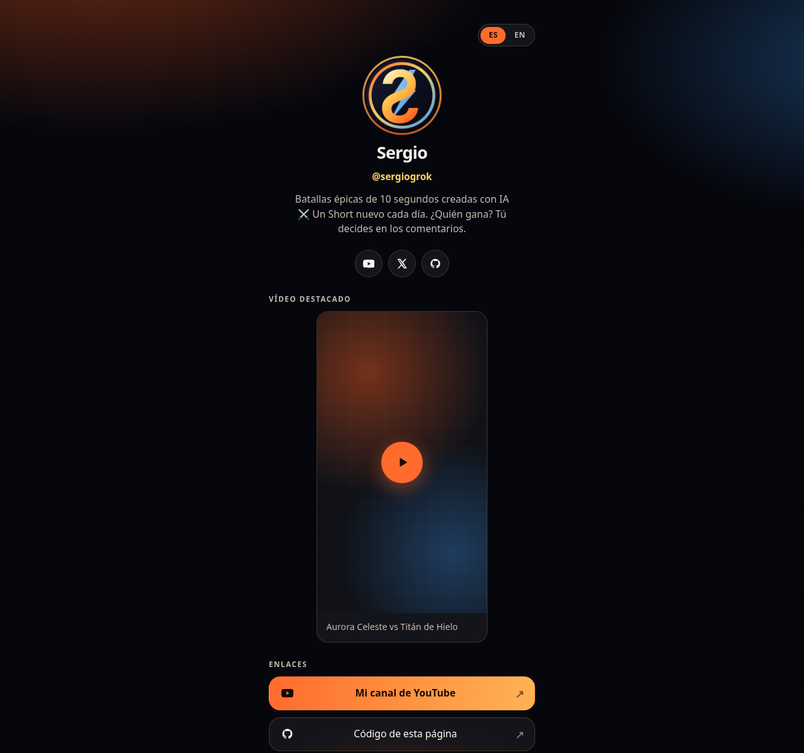

# bio-enlaces

Página de enlaces autoalojada para creadores. Un solo archivo de configuración, salida estática con [Astro](https://astro.build), lista para Hostinger y para un VPS con Docker Compose.

[](https://www.hostinger.com/deploy?template=serg-hash/bio-enlaces&ref=TU_CODIGO_SOCIO)

> **Código de socio:** deja `TU_CODIGO_SOCIO` hasta inscribirte en el [programa Open Source Partners de Hostinger](https://www.hostinger.com/open-source-partners). Después sustituye el placeholder por tu código.

[](https://github.com/serg-hash/bio-enlaces/actions/workflows/ci.yml)
[](LICENSE)
[](https://astro.build)



<p align="center"><em>Vista completa en móvil: <a href="docs/screenshot.png">docs/screenshot.png</a></em></p>

El contenido por defecto es la página real de **Sergio** (`@sergiogrok`). Cámbialo en `src/config.ts` por el tuyo. Hay un ejemplo ficticio listo para copiar en [`examples/lumen-vega.config.ts`](examples/lumen-vega.config.ts).

## Características

- **Un archivo de config** (`src/config.ts`): nombre, avatar, bio, enlaces, redes, tema y vídeo de YouTube opcional.
- **Temas listos**: `epic` (oscuro, batallas), `midnight`, `aurora`, `sunset`, `ocean`, `forest`, `candy` (claro) y `contrast`.
- **Interfaz en español e inglés** (`/` y `/en/`), conmutador en la esquina.
- **Móvil primero**, accesible (`:focus-visible`, skip-link, contraste, `prefers-reduced-motion`).
- **SEO y redes**: title, description, canonical, hreflang, Open Graph, Twitter Card, JSON-LD, favicon, sitemap y manifest.
- **Sin rastreo**: el embed de YouTube usa `youtube-nocookie` y **solo carga el iframe cuando pulsas reproducir**.
- **Sin secretos ni servicios de pago.** `npm install` → `npm run build` → carpeta `dist/`.
- **Docker Compose** para VPS y botón **Deploy on Hostinger**.

## Inicio rápido

Requisitos: [Node.js 22.12+](https://nodejs.org/) (Astro 7).

```bash
git clone https://github.com/serg-hash/bio-enlaces.git
cd bio-enlaces
npm install
npm run dev
```

Abre [http://localhost:4321](http://localhost:4321). Para producción local:

```bash
npm run build
npm run preview
```

La build deja el sitio en `dist/`. Ese es el directorio que Hostinger (y cualquier host estático) debe publicar.

## Cómo personalizar

Edita **`src/config.ts`**. Está comentado en español e inglés. Lo habitual:

| Campo | Qué cambia |
| --- | --- |
| `site.url` | URL pública (canonical, OG, sitemap) |
| `site.name`, `handle`, `bio` | Perfil |
| `site.avatar` | Imagen en `public/` (p. ej. `/avatar.jpg`) |
| `site.theme` | `"epic"`, `"midnight"` o un objeto de colores |
| `site.socials` | Iconos de YouTube, X, Instagram, TikTok, Twitch, GitHub… |
| `site.links` | Botones (título, URL, emoji o icono, `featured`) |
| `site.featuredVideo` | `{ enabled, id, title, shorts? }` — `id` puede ser un ID o una URL (`watch` o `/shorts/…`) |

Sustituye `public/avatar.png` por tu foto si quieres. Los pictogramas extra se añaden en `src/icons.ts`.

¿Prefieres el demo genérico? Copia `exampleSite` de [`examples/lumen-vega.config.ts`](examples/lumen-vega.config.ts) sobre `site` en `src/config.ts`.

Después:

```bash
npm run build
```

## Desplegar

### Hostinger (un clic / Node.js)

1. Pulsa el botón **Deploy on Hostinger** del principio (o sube este repo en hPanel → sitio Node.js).
2. Hostinger detecta Astro con estos valores; si te pide confirmarlos:

   | Campo | Valor |
   | --- | --- |
   | Tipo de aplicación | `astro` |
   | Script de build | `build` |
   | Directorio de salida | `dist` |
   | Entry file | *(vacío — es un sitio estático)* |
   | Node.js | 22 |

3. No hace falta ninguna variable de entorno.

Más detalle: [Astro en Hostinger](https://docs.hostinger.com/node.js/overview-1/astro).

### Docker / VPS

```bash
docker compose up --build -d
```

La página queda en [http://localhost:8080](http://localhost:8080). En un VPS de Hostinger, Docker Manager puede usar el `docker-compose.yml` de este repo. Para publicar en el puerto 80, cambia el mapeo a `"80:80"`.

### Otros hosts estáticos

`npm run build` y publica `dist/` en Netlify, Cloudflare Pages, GitHub Pages, Nginx, etc.

| Host | Build | Publicar |
| --- | --- | --- |
| Netlify / Cloudflare Pages | `npm run build` | `dist` |
| GitHub Pages | `npm run build` | contenido de `dist` |
| Nginx | `npm run build` | `root` → `dist` |

## Temas sugeridos del repositorio

Si eres el dueño del repo, en GitHub → About → Topics:

`astro` · `link-in-bio` · `biolink` · `self-hosted` · `hostinger` · `docker` · `docker-compose` · `static-site` · `creator-tools` · `youtube` · `spanish` · `open-source` · `mit-license` · `no-tracking`

## Créditos

Hecho por **Sergio Trujillo Muñoz** ([serg-hash](https://github.com/serg-hash) / [@sergiogrok](https://x.com/sergiogrok)). El default del repo es su página de creador; el ejemplo ficticio **Lumen Vega** está en [`examples/lumen-vega.config.ts`](examples/lumen-vega.config.ts).

Licencia [MIT](LICENSE). Contribuciones: [CONTRIBUTING.md](CONTRIBUTING.md).

---

# English

Self-hosted link-in-bio page for creators. One config file, static Astro output, ready for Hostinger’s Open Source Partners program and for a VPS with Docker Compose.

[](https://www.hostinger.com/deploy?template=serg-hash/bio-enlaces&ref=TU_CODIGO_SOCIO)

> **Partner code:** leave `TU_CODIGO_SOCIO` until you join [Hostinger Open Source Partners](https://www.hostinger.com/open-source-partners), then replace the placeholder.

## Features

- Single well-commented config (`src/config.ts`): profile, links, socials, preset themes, optional YouTube embed.
- Spanish + English UI (`/` and `/en/`).
- Mobile-first, accessible, no tracking, no paid services, no secrets.
- `npm install` / `npm run build` / `dist/` works out of the box.
- Dockerfile + `docker-compose.yml` for VPS deploys.

## Quick start

```bash
npm install
npm run dev
```

Edit `src/config.ts`, drop your avatar into `public/`, then `npm run build`. Output is `dist/`. A fictional demo profile lives in `examples/lumen-vega.config.ts`.

## Deploy

**Hostinger one-click:** use the button above. Build script `build`, output directory `dist`, leave the entry file empty (static Astro). Node 22.

**Docker:** `docker compose up --build -d` → http://localhost:8080

**Any static host:** publish the `dist/` folder.

## License

MIT © Sergio Trujillo Muñoz / serg-hash
