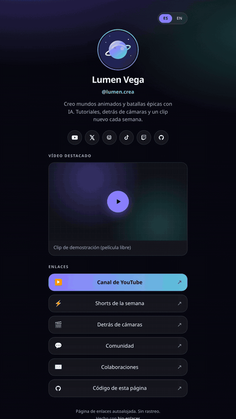

# bio-enlaces

Una página de enlaces autoalojada: un archivo de configuración, HTML estático, sin cuentas ni rastreo.

**[Demo en vivo](https://serg-hash.github.io/bio-enlaces/)** · [Deploy on Hostinger](https://www.hostinger.com/deploy?template=serg-hash/bio-enlaces)

<!-- To add a Hostinger partner referral later, append &ref=YOUR_CODE to the deploy URL above. See CONTRIBUTING.md. -->

[](https://serg-hash.github.io/bio-enlaces/)

[](https://github.com/serg-hash/bio-enlaces/actions/workflows/ci.yml)
[](https://github.com/serg-hash/bio-enlaces/actions/workflows/pages.yml)
[](LICENSE)
[](https://astro.build)

<p align="center"><em>Captura completa: <a href="docs/screenshot-desktop.png">escritorio</a> · <a href="docs/screenshot.png">móvil</a></em></p>

La demo usa un perfil **ficticio** (Lumen Vega). Cámbialo en `src/config.ts`. La página real de Sergio está en [`examples/sergio.config.ts`](examples/sergio.config.ts).

## Características

- **Un archivo de config** (`src/config.ts`): nombre, avatar, bio, enlaces, redes, tema y vídeo de YouTube opcional.
- **Temas listos**: `epic`, `midnight`, `aurora`, `sunset`, `ocean`, `forest`, `candy` (claro) y `contrast`.
- **Interfaz en español e inglés** (`/` y `/en/`), conmutador en la esquina.
- **Móvil primero**, accesible (`:focus-visible`, skip-link, contraste, `prefers-reduced-motion`).
- **SEO y redes**: title, description, canonical, hreflang, Open Graph, Twitter Card, JSON-LD, favicon, sitemap y manifest.
- **Sin rastreo**: el embed de YouTube usa `youtube-nocookie` y **solo carga el iframe cuando pulsas reproducir**. Los Shorts salen en 9:16.
- **Sin secretos ni servicios de pago.** `npm install` → `npm run build` → carpeta `dist/`.
- **GitHub Pages**, **Hostinger** o **Docker Compose** en un VPS.

## En qué se diferencia de LittleLink y LinkStack

Comparación según lo que este repo **hace de verdad**:

| | bio-enlaces | [LittleLink](https://github.com/sethcottle/littlelink) | [LinkStack](https://github.com/LinkStackOrg/LinkStack) |
| --- | --- | --- | --- |
| Salida | Sitio estático (Astro → `dist/`) | HTML/CSS estático que editas a mano | App PHP (Laravel) con base de datos |
| Personalización | Un objeto TypeScript | Editar `index.html` y CSS | Panel de administración |
| Idiomas | UI en ES y EN, textos por idioma | No hay i18n de producto | Depende de la instalación |
| Vídeo | YouTube opcional, click-to-load, sin cookies previas | No viene de serie | Enlaces; no es el mismo modelo estático |
| SEO | Canonical, hreflang, OG, JSON-LD, sitemap | Lo que pongas en el HTML | Lo que configure la app |
| Hosting | Cualquier estático, Pages, Hostinger, Docker | Cualquier estático | Hosting PHP |

No hay analítica de clics, cuentas de usuario ni panel. Si necesitas eso, LinkStack encaja mejor. Si quieres solo HTML sin build, LittleLink es más simple.

## Inicio rápido

Requisitos: [Node.js 22.12+](https://nodejs.org/) (Astro 7).

```bash
git clone https://github.com/serg-hash/bio-enlaces.git
cd bio-enlaces
npm install
npm run dev
```

Abre [http://localhost:4321](http://localhost:4321). Para producción local:

```bash
npm run build
npm run preview
```

La build deja el sitio en `dist/`. Ese es el directorio que hay que publicar.

## Cómo personalizar

Edita **`src/config.ts`**. Está comentado en español e inglés. Lo habitual:

| Campo | Qué cambia |
| --- | --- |
| `site.url` | URL pública (canonical, OG, sitemap) |
| `site.name`, `handle`, `bio` | Perfil |
| `site.avatar` | Imagen en `public/` (p. ej. `/avatar.jpg`) |
| `site.theme` | `"midnight"`, `"epic"` o un objeto de colores |
| `site.socials` | Iconos de YouTube, X, Instagram, TikTok, Twitch, GitHub… |
| `site.links` | Botones (título, URL, emoji o icono, `featured`) |
| `site.featuredVideo` | `{ enabled, id, title, shorts? }` — `id` puede ser un ID o una URL (`watch` o `/shorts/…`) |

Sustituye `public/avatar.png` por tu foto si quieres. Los pictogramas extra se añaden en `src/icons.ts`.

¿Quieres la página de Sergio en vez de la demo? Copia `sergioSite` de [`examples/sergio.config.ts`](examples/sergio.config.ts) sobre `site`. Para restaurar Lumen Vega, usa [`examples/lumen-vega.config.ts`](examples/lumen-vega.config.ts).

Después:

```bash
npm run build
```

## Desplegar

### GitHub Pages (la demo de este repo)

El workflow [`.github/workflows/pages.yml`](.github/workflows/pages.yml) construye con `BASE_PATH=/<nombre-del-repo>/` y publica `dist/` en cada push a `main`.

1. En el repo: **Settings → Pages → Source: GitHub Actions**.
2. Push a `main` (o **Actions → GitHub Pages → Run workflow**).
3. La URL queda en `https://<usuario>.github.io/<repo>/`.

Este proyecto: [https://serg-hash.github.io/bio-enlaces/](https://serg-hash.github.io/bio-enlaces/).

Pon `site.url` en `src/config.ts` a esa URL (sin barra final). El código usa `withBase()` para que CSS, avatar, favicon y el conmutador ES/EN funcionen bajo `/bio-enlaces/`.

Si el workflow falla con un error de Pages, falta el paso 1: GitHub no activa Pages solo por añadir el YAML.

### Hostinger

1. Pulsa **[Deploy on Hostinger](https://www.hostinger.com/deploy?template=serg-hash/bio-enlaces)** (o sube este repo en hPanel → sitio Node.js).
2. Hostinger detecta Astro con estos valores; si te pide confirmarlos:

   | Campo | Valor |
   | --- | --- |
   | Tipo de aplicación | `astro` |
   | Script de build | `build` |
   | Directorio de salida | `dist` |
   | Entry file | *(vacío — es un sitio estático)* |
   | Node.js | 22 |

3. No hace falta ninguna variable de entorno. No definas `BASE_PATH` (el sitio vive en `/`).
4. Cambia `site.url` a tu dominio.

Más detalle: [Astro en Hostinger](https://docs.hostinger.com/node.js/overview-1/astro).

### Docker / VPS

```bash
docker compose up --build -d
```

La página queda en [http://localhost:8080](http://localhost:8080). En un VPS de Hostinger, Docker Manager puede usar el `docker-compose.yml` de este repo. Para publicar en el puerto 80, cambia el mapeo a `"80:80"`.

### Cualquier host estático

`npm run build` y publica `dist/` (Netlify, Cloudflare Pages, Nginx, carpeta `public_html`…).

| Host | Build | Publicar |
| --- | --- | --- |
| Netlify / Cloudflare Pages | `npm run build` | `dist` |
| GitHub Pages | workflow de este repo | `dist` (con `BASE_PATH`) |
| Nginx / Hostinger estático | `npm run build` | `root` → `dist` |

Si el sitio **no** está en la raíz del dominio (como en Pages), exporta `BASE_PATH=/subcarpeta/` al construir.

## Créditos

Hecho por **Sergio Trujillo Muñoz** ([serg-hash](https://github.com/serg-hash) / [@sergiogrok](https://x.com/sergiogrok)). El default del repo es el perfil ficticio **Lumen Vega**; el ejemplo opcional de Sergio está en [`examples/sergio.config.ts`](examples/sergio.config.ts).

Licencia [MIT](LICENSE). Contribuciones: [CONTRIBUTING.md](CONTRIBUTING.md). Cambios: [CHANGELOG.md](CHANGELOG.md).

---

# English

A self-hosted link-in-bio page: one config file, static HTML, no accounts and no tracking.

**[Live demo](https://serg-hash.github.io/bio-enlaces/)** · [Deploy on Hostinger](https://www.hostinger.com/deploy?template=serg-hash/bio-enlaces)

<!-- To add a Hostinger partner referral later, append &ref=YOUR_CODE to the deploy URL above. See CONTRIBUTING.md. -->

## Features

- Single well-commented config (`src/config.ts`): profile, links, socials, preset themes, optional YouTube embed.
- Spanish + English UI (`/` and `/en/`).
- Mobile-first, accessible, no tracking, no paid services, no secrets.
- YouTube loads only after you press play (`youtube-nocookie`). Shorts use a 9:16 player.
- `npm install` / `npm run build` / `dist/` works out of the box.
- GitHub Pages workflow, Hostinger one-click, and Docker Compose for a VPS.

The live demo is a **fictional** profile (Lumen Vega). Sergio’s real page is the optional file [`examples/sergio.config.ts`](examples/sergio.config.ts).

## How it differs from LittleLink and LinkStack

- **LittleLink** is hand-edited static HTML/CSS. No build, no first-class i18n, no click-to-load YouTube helper, no JSON-LD/hreflang/sitemap unless you add them. Simpler if you want raw HTML.
- **LinkStack** is a PHP/Laravel app with a database, admin UI, users and click stats. It needs PHP hosting; it is not a static `dist/` folder.
- **bio-enlaces** is a static Astro build from one TypeScript config, with ES/EN UI, theme presets, privacy-friendly YouTube, and SEO tags. It has no accounts and no click analytics.

## Quick start

```bash
npm install
npm run dev
```

Edit `src/config.ts`, drop your avatar into `public/`, then `npm run build`. Output is `dist/`.

## Deploy

**GitHub Pages:** Settings → Pages → Source: **GitHub Actions**. Push to `main`. The workflow sets `BASE_PATH=/<repo>/`. Demo for this repo: https://serg-hash.github.io/bio-enlaces/

**Hostinger:** use the button above. Build script `build`, output directory `dist`, leave the entry file empty (static Astro). Node 22. Do not set `BASE_PATH`. Change `site.url` to your domain.

**Docker:** `docker compose up --build -d` → http://localhost:8080

**Any static host:** publish the `dist/` folder. If the site is not at the domain root, build with `BASE_PATH=/subdir/`.

## License

MIT © Sergio Trujillo Muñoz / serg-hash
